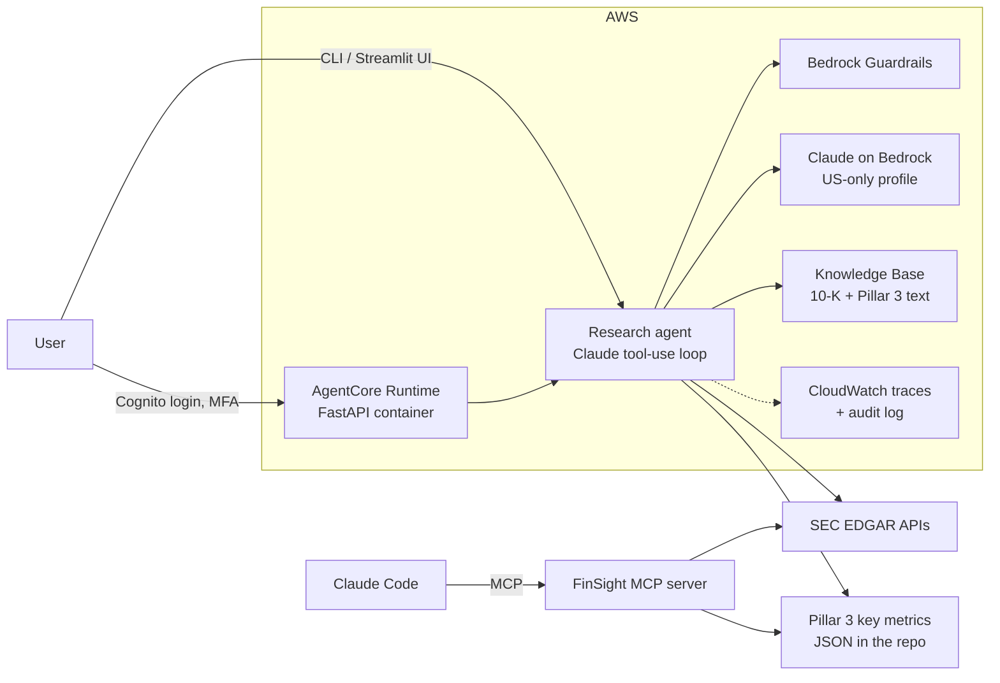

# FinSight

[](https://github.com/AkhilKadarla/Agentic_AI/actions/workflows/ci.yml)

An AI research analyst agent for the finance industry. Ask it *"Is Costco converting its
earnings into free cash flow?"* and it pulls reported figures from SEC filings, reads the
company's 10-K, shows its calculations, and writes a structured research note with charts.
It also answers capital questions about Morgan Stanley's regulated entities from their public
Pillar 3 reports (CET1, risk-weighted assets, leverage, TLAC). Built step by step to learn
agentic AI engineering the way a financial firm would run it.

## Highlights

- **Agent:** Claude tool-use loop in Python with streaming, conversation memory and
  structured outputs (Pydantic research notes)
- **RAG:** Amazon Bedrock Knowledge Base (S3 Vectors) over 10-K Risk Factors and MD&A,
  filtered by company and section, and over the Pillar 3 report text
- **Regulatory reports:** key capital metrics read from Morgan Stanley's public Pillar 3 PDFs
  by table position, with the PDFs pinned by SHA-256 and the results reviewed in git
- **Guardrails:** Amazon Bedrock Guardrails check every question, and every answer paragraph
  is checked for grounding in the fetched data; fails closed
- **Evals:** 36-case number-accuracy suite (programmatic grading + LLM judge): 50/50 on the
  SEC baseline, 11/11 on the Pillar 3 pilot
- **Observability:** OpenTelemetry traces (local and CloudWatch) and an audit log of every
  model call
- **Deployment:** FastAPI + Docker on **Amazon Bedrock AgentCore Runtime**, Cognito login with
  MFA, least-privilege IAM as code, keyless GitHub Actions deploys (OIDC) with approval
- **MCP:** the SEC and Pillar 3 tools also run as an MCP server for Claude Code and other
  MCP clients
- **Quality:** 350+ tests (no network), lint and container checks in CI on every pull request



## Roadmap

- [x] **Phase 0 - Foundation:** uv, Python 3.12, project layout, secrets handling
- [x] **Phase 1 - Code quality:** ruff, pytest, pre-commit hooks
- [x] **Phase 2 - CI/CD:** GitHub Actions, branch protection, Dependabot
- [x] **Phase 3 - First agent:** raw LLM call → tool use → agent loop
- [x] **Phase 4 - Agent upgrades:** streaming + conversation memory, structured research notes
- [x] **Phase 5 - Interactive UI:** Streamlit chat app with live tool calls and charts
- [x] **Phase 6 - AWS Bedrock:** Claude on Bedrock, Guardrails, Knowledge Base (RAG) over 10-K text
- [x] **Phase 7 - Evals & observability:** number-accuracy eval, OpenTelemetry tracing, Bedrock invocation logging
- [x] **Phase 8 - Deploy:** FastAPI + Docker on Bedrock AgentCore Runtime, Cognito login (MFA),
  keyless CI/CD via OIDC with approval, CloudWatch traces
- [x] **Phase 9 - MCP server:** the SEC tools for any MCP-compatible agent (e.g. Claude Code)
- [x] **Phase 10 - Regulatory reports:** Morgan Stanley Pillar 3 key metrics and report text
  search, with an eval pilot

## Quickstart

Requires [uv](https://docs.astral.sh/uv/).

```bash
uv sync                  # create .venv and install dependencies
cp .env.example .env     # then fill in your keys
uv run finsight ask "What is EBITDA?"   # ask Claude a finance question
uv run finsight research "Compare Apple and Microsoft revenue growth"   # agent + live SEC data
uv run finsight note "Assess Costco's financial health"   # research + save a structured note
uv run finsight chat     # interactive chat; /note saves a note from the conversation
uv run finsight ui       # web app at http://localhost:8501
uv run pre-commit install   # one-time: enable git commit hooks
```

## Running on Amazon Bedrock

FinSight runs on the Anthropic API by default. To use Claude on Amazon Bedrock instead:

```bash
aws configure sso                      # one-time: create the "finsight" SSO profile
aws sso login --profile finsight       # each day: short-lived credentials, no keys
```

Then set in `.env`:

```bash
FINSIGHT_PROVIDER=bedrock
AWS_PROFILE=finsight
AWS_REGION=us-east-1
FINSIGHT_BEDROCK_MODEL=us.anthropic.claude-sonnet-4-6   # "us." = US-only processing
```

Everything else (chat, notes, UI) works the same. Differences are isolated in
`src/finsight/providers.py`.

## Compliance guardrail (Amazon Bedrock Guardrails)

An optional guardrail checks every question before Claude sees it and every answer after
it streams, with either provider (it needs an AWS login):

- **Blocks** personalized investment advice, insider information, personal data
  (SSNs, card and bank account numbers), prompt attacks and harmful content
- **Flags** answer paragraphs not directly supported by the fetched data (SEC figures,
  10-K passages, Pillar 3 metrics and report passages) for human review: unverifiable
  calculations, or claims from the model's memory
- **Fails closed**: if the guardrail can't be reached, FinSight won't answer

```bash
FINSIGHT_GUARDRAIL_ID=<your guardrail id>
FINSIGHT_GUARDRAIL_VERSION=4          # pin a published version, never DRAFT in real use
```

Before publishing a new guardrail version, run the regression suite against the draft:
`uv run python scripts/guardrail_suite.py DRAFT`

## 10-K text search (Amazon Bedrock Knowledge Base)

FinSight can index the narrative sections of 10-Ks (Risk Factors, MD&A) into a Bedrock
Knowledge Base backed by S3 Vectors, so answers can cite what companies actually wrote.

```bash
uv run finsight index TSLA AAPL      # download, extract sections, upload, sync
uv run finsight index --list         # what's indexed
```

With a Knowledge Base configured, the agent gets a `search_filings` tool and answers
"why" questions by quoting the filing; the guardrail grounds those quotes too.

The same Knowledge Base can hold the Pillar 3 report text too (`finsight pillar3 --index`,
see below), which gives the agent a `search_reports` tool.

Settings: `FINSIGHT_KB_ID`, `FINSIGHT_KB_DATA_SOURCE_ID`, `FINSIGHT_FILINGS_BUCKET`.
The IAM policy the developer role needs is in `infra/iam/`.

## Regulatory reports (Pillar 3)

Banks publish Pillar 3 reports so anyone can check their capital strength. FinSight reads
Morgan Stanley's public reports for its UK and EU groups, as at 31 December 2022 and 2023.
Each group's report also covers its main subsidiary:

| Report | Entities | Currency |
|---|---|---|
| MSI Group (Morgan Stanley International Limited, UK) | MSI Group, MSIP (Morgan Stanley & Co. International plc) | USD |
| MSEHSE Group (Morgan Stanley Europe Holding SE, EU) | MSEHSE Group, MSESE Consol (Morgan Stanley Europe SE; 2023 report only) | EUR |

- **`get_key_metrics`** answers from `src/finsight/data/pillar3_key_metrics.json`: CET1,
  Tier 1 and total capital, RWAs, capital ratios, leverage ratio, and TLAC (group entities
  only). Each value comes with its table and page. The tool reads only this file, so it
  needs no network, AWS or PDF library at question time.
- **`search_reports`** (with a Knowledge Base) finds report passages for "why" questions,
  cited by chapter and page.

The JSON is built from the PDFs and committed. Rebuild it after adding a report:

```bash
uv run finsight pillar3            # download the PDFs to data/reg_reports/, rebuild the JSON
uv run finsight pillar3 --index    # also add the reports' text to the Knowledge Base
```

The build reads the Key Metrics (KM1) and TLAC tables by word position, because plain text
drops blank quarters. It refuses to finish if a PDF's SHA-256 doesn't match the pinned one,
a value doesn't line up with a column, or a metric is missing. Review the JSON diff like
code. `pdfplumber` lives in the `reports` dependency group, so it stays out of the Docker
image. Only public reports are used.

## Evals

`evals/number_accuracy/` measures whether FinSight gets financial figures right: 36
reviewed questions, graded automatically (numbers) and by a Claude Haiku judge (traps):

- 25 from SEC data: single facts, multi-year, calculations, comparisons, and "unavailable"
  traps. Questions with an answer name the year it belongs to, so a newly filed 10-K can't
  change the right answer.
- 11 from Pillar 3: ratios, RWAs, TLAC, leverage, two-year comparisons, and a quarter the
  report leaves blank

```bash
uv run python -m evals.number_accuracy.run_eval --approve-harness   # after reviewing changes
uv run python -m evals.number_accuracy.run_eval --reps 2            # ~$0.60, ~3 min
uv run python -m evals.number_accuracy.run_eval --report
```

Results (Sonnet 4.6 on Bedrock), with transcripts in `.claude/hillclimb/number_accuracy/`:

- `baseline/`: SEC cases, **50/50 correct, 50/50 from fetched data**
- `pillar3_pilot/`: Pillar 3 cases, **11/11 correct, 11/11 from fetched data** (one rep)
- `pillar3_regression/`: SEC cases after the Pillar 3 changes, 46/50. All four misses were
  Costco questions whose "most recent fiscal year" moved when Costco filed a new 10-K, which
  is why questions now name the year. The suite hasn't been re-run since that fix.

## Observability

Every question is recorded as an OpenTelemetry trace: a span per guardrail check, model
call and tool call, with timing, tokens and cost (GenAI semantic conventions). Traces are
written to `logs/traces/<date>.jsonl` (git-ignored, deleted after 30 days).

```bash
uv run finsight traces              # recent questions: time, cost, tools, outcome
uv run finsight traces 719df4fc     # one question, step by step
```

Independently, AWS records every Bedrock model call (who, when, model, tokens, request and
response) in CloudWatch Logs: `/finsight/bedrock-invocations`, 30-day retention. See `infra/iam/`.

## Web API (AgentCore Runtime contract)

`src/finsight/api.py` serves FinSight over HTTP: `GET /ping`, `GET /info`, and
`POST /invocations` (`{"prompt": ..., "action": "chat" | "note" | "reset"}`), streaming
agent events as server-sent events. Sessions are keyed by the
`X-Amzn-Bedrock-AgentCore-Runtime-Session-Id` header.

```bash
uv run uvicorn finsight.api:app --host 127.0.0.1 --port 8080   # local only (no auth)
```

The `Dockerfile` builds the linux/arm64 image AgentCore requires (no UI libraries, no
secrets, non-root user); CI builds and health-checks it on every pull request.

## Deployment (Amazon Bedrock AgentCore Runtime)

After CI passes on `main`, `.github/workflows/deploy.yml` waits for approval in the
`production` environment, logs in to AWS with OIDC (no stored keys), pushes the image to ECR
(immutable tags) and creates or updates the AgentCore runtime (`deploy/agentcore.py`).

- **Login required:** AgentCore accepts only Cognito access tokens from FinSight's app client
  (invite-only user pool, MFA required); the deploy role can't create a runtime without it
- **Least privilege:** the app's role can only read (Claude via the US-only profile, the
  guardrail, the Knowledge Base); IAM policies live in `infra/` as code
- **Traces** go to CloudWatch without question/answer text; the Bedrock invocation log is the
  audited record of content

Use the deployed agent from the terminal or the web UI (logs in with PKCE in your browser):

```bash
uv run finsight remote                            # chat with the deployed agent
FINSIGHT_UI_BACKEND=deployed uv run finsight ui   # web UI with login
```

## MCP server

FinSight's tools (`get_company_filings`, `get_financial_facts`, `get_key_metrics`, and with
a Knowledge Base `search_filings` and `search_reports`), a metrics resource and a research
prompt are available to any MCP client. In this repo, `.mcp.json` registers the server for
Claude Code automatically; just ask, e.g. *"Using finsight, how has Apple's revenue changed
over 3 years?"*

```bash
uv run finsight mcp      # the stdio server that MCP clients start
```

## Development checks

```bash
uv run ruff check .          # lint (find bugs & style issues)
uv run ruff format .         # auto-format code
uv run pytest                # run tests with coverage
uv run pre-commit run --all-files   # run every commit hook
```

## Project layout

```
src/finsight/   # application code
  cli.py        # command-line interface
  agent.py      # research agent: loop, memory, streaming events
  providers.py  # Anthropic API vs Amazon Bedrock (client + request settings)
  guardrail.py  # Bedrock Guardrails: input/output checks, grounding per paragraph
  filings.py    # extract Risk Factors / MD&A text from 10-K HTML
  knowledge_base.py  # Bedrock Knowledge Base: upload with labels, sync, search
  pillar3.py    # Pillar 3 PDFs -> key metrics JSON; report pages for the Knowledge Base
  data/         # pillar3_key_metrics.json (built by `finsight pillar3`, reviewed in git)
  tracing.py    # OpenTelemetry spans, local JSONL exporter, retention, trace viewer
  llm.py        # simplest single Claude call (ask)
  notes.py      # ResearchNote schema (Pydantic), Markdown rendering, saving
  ui.py         # Streamlit web app (renders the agent's events)
  api.py        # FastAPI web API (AgentCore Runtime contract, SSE streaming)
  remote.py     # PKCE login + client for the deployed agent
  mcp_server.py # the SEC tools as an MCP server
  charts.py     # Altair charts for research notes
  tools.py      # tool definitions Claude can call
  sec.py        # SEC EDGAR API client
  config.py     # settings loaded from .env
tests/          # automated tests (no network, no API calls)
evals/          # number-accuracy eval suite
deploy/         # AgentCore create-or-update script (run by GitHub Actions)
scripts/        # manual live checks (e.g. guardrail regression suite)
infra/          # infrastructure as code (IAM policies, Cognito, ECR)
```

## License

[MIT](LICENSE)

> Disclaimer: FinSight is a learning project and does not provide financial advice.
